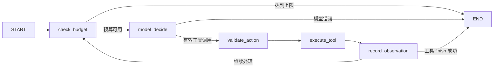

# 方案与技术取舍

## 调用流程

`CLI → 校验请求 → 登记不可变请求指纹 → 为每项素材调用 LangGraph → 按真实工具状态组装结果`。每项素材构建一个 `StateGraph(ItemState)`；同一请求的总决策数、工具调用数和本批次暂定时段在素材之间继续传递。

| LangGraph 节点 | 输入与职责 | 下一条边 |
| --- | --- | --- |
| `check_budget` | 核对全请求决策数、工具数与当前素材轮数；超限记录明确的 stop_reason | 未超限到 `model_decide`，否则 END |
| `model_decide` | 将含实际观察的消息交给 DeepSeek；要求恰好一个原生工具调用 | 有效到 `validate_action`，模型错误到 END |
| `validate_action` | 解析模型返回的 JSON 参数并计入工具调用预算 | 到 `execute_tool` |
| `execute_tool` | 调用带业务前置条件与权限校验的工具白名单 | 到 `record_observation` |
| `record_observation` | 记录动作、参数、公开事实依据、工具回执，并把原生 tool 消息送回模型上下文 | `finish` 成功则 END，否则回 `check_budget` |

图的条件边只依据“预算/模型错误/工具是否结束”路由，不根据素材风险或冲突写死下一业务动作。补查、查当日候选、重试和结束由 `model_decide` 在观察工具结果后选择。图状态含消息、计数、当前动作、观察和停止原因；草稿与正式时段占位仍持久化在 SQLite。当前 CLI 请求同步执行，不使用 LangGraph checkpointer 暂停会话。

系统提示词单独保存在 `src/asset_agent/prompts.py`，`agent.py` 只导入并装入 system 消息；提示词与图编排代码分开维护。

模型实现 `decide(messages, tool_schemas)`；真实模式通过 HTTPS POST `/chat/completions`，默认 model=`deepseek-flash`，thinking disabled，tool_choice required，parallel_tool_calls false。每轮只允许一个原生工具调用。工具调用 ID 原样用于后续 tool 消息，未在对话中插入伪造的模型动作。

依据：[官方工具调用](https://api-docs.deepseek.com/guides/tool_calls/)、[官方参数](https://api-docs.deepseek.com/api/create-chat-completion/)，2026-10-28 核对。不使用 Beta strict 功能，参数在本地显式校验。不采集 reasoning_content，只记录动作参数中一句公开事实依据。

## 动态决策

四个业务工具为 `read_material(section)`、`check_rules()`、`query_slots(scope)`、`save_draft(slot)`，另有 `finish(outcome)`。素材 ID、request_id 和身份由当前执行上下文绑定，不能由模型改写。

正常路径：读资料、审规则、查原时段、保存、结束。冲突路径：原时段返回占用后，模型选择扩大查询，再选可用候选、保存待确认提案、结束。缺资料路径：模型根据规则返回的 supplementary_available 选择补查，之后重新审核，仍缺失则请求信息。

`ranked_available_slots` 是工具按距离和等距离较晚优先计算的候选排序。它不自动触发查询或保存，也不赋予确认权限；动作和候选选择仍由模型生成。

## 信任与状态

素材正文仅作为数据送入模型；系统提示明确不执行资料中的指令。工具白名单及严格参数集拒绝模型提供 approved 等越权字段。CLI 输入也不接受自带审批字段。

规则检查使用可信资料和内部规则；保存再次检查资料签名与规则结果。`finish` 的结果必须被实际工具观察支持。最终输出由代码组装，不采用模型自由文本作为保存成功的依据。
授权状态必须为 `cleared` 才能通过审核；`denied` 阻断，`unknown` 或缺失则要求补齐授权状态。证明编号非空不能代替授权状态。此约束由规则工具执行，模型不能自行豁免。

hard/preferred 均保留 requested_at，任何替代时间均 pending_confirmation，scheduled_at=null。用户独立执行 confirm，提供草稿 ID、精确版本和具体时段；确认前重新检查规则签名和时段。经确认的同一提案可以在后续重试中保留确认；资料变化则不复用旧确认。

## 草稿与事务

SQLite 表：requests（原请求指纹）、drafts（唯一请求/素材、版本和提案）、slot_claims（正式排期/ready 草稿占位）、draft_events（保存/确认/失效事件）。

- `UNIQUE(request_id, material_id)` 防重复，输入发生变化则拒绝复用请求 ID。
- `PRIMARY KEY(channel, slot)` 防占位重复；`BEGIN IMMEDIATE` 内完成检查与写入，两个并发进程不能同时获得同一槽位。
- 同一草稿查询排期时排除自己的占位；不会因重试与自己冲突。
- 原样保存返回 existing；外部状态变化更新同一 ID、递增版本。
- 失败在事务内回滚草稿、占位与事件。调用失败不意味着删除历史成功记录；输出明确本次保存结果。
- 待确认草稿不占正式时段，同批次候选由临时集合排他，跨请求提案在确认时仲裁。
- 导入变更排期会使冲突 ready 草稿失效，保留事件；该管理能力不暴露给模型。

SQLite 事务依据：[Python sqlite3](https://docs.python.org/3/library/sqlite3.html)、[SQLite UPSERT](https://www.sqlite.org/lang_upsert.html)。

## 上限与失败

默认每请求 60 次模型决策/50 次工具调用，每项 12 轮；finish、无效动作和失败动作均计数。最多两次保存尝试。模型调用超时默认 45 秒。达到上限输出 incomplete 和具体 stop_reason，不抹掉已经成功保存的状态。

模型不可用或响应无效时不切换 Mock，运行记录保留 model_error。离线 Mock 仅用于流程验证。业务工具异常返回结构化错误，模型选择重试或失败结束。

## 取舍

按提交者要求迁移到 LangGraph 1.2.18，使用 `StateGraph`、普通边、条件边、`START/END` 和编译后 `invoke` 承担工作流编排；原生 DeepSeek function calling 仍承担每轮动作选择，本地工具和 SQLite 仍承担业务事实与事务。这样节点、循环和停止路径可在代码中直接核对。代价是新增框架依赖；本题不使用 LangGraph 的多 Agent、持久会话或部署能力。Graph API 依据：[LangGraph 官方文档](https://docs.langchain.com/oss/python/langgraph/graph-api)。
